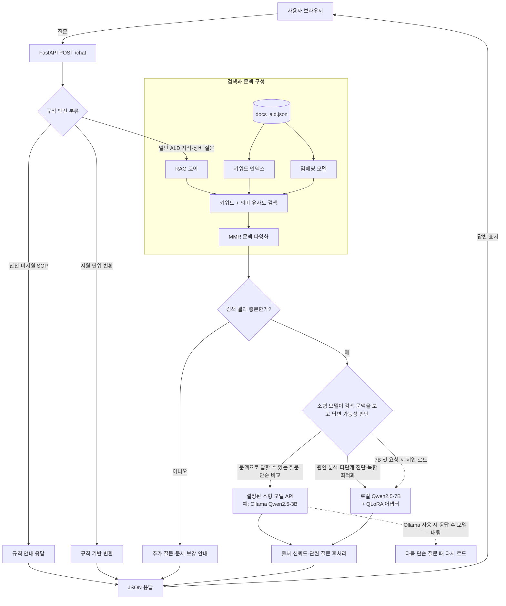

# ALD RAG

반도체 Atomic Layer Deposition(ALD) 지식 문서를 검색해 한국어 답변을 제공하는 RAG 서비스입니다. 키워드 검색과 임베딩 유사도를 결합해 근거 문맥을 찾고, 안전·단위 변환 등 규칙으로 처리할 수 있는 요청은 LLM 호출 전에 분기합니다.

## 현재 설계

```text
브라우저 UI (frontend/)
        │ HTTP / 허용 출처만 CORS 허용
        ▼
FastAPI (backend/app.py)
        │
        ├── 규칙 라우터 (rule_engine.py)
        │     ├── 안전 관련 요청 차단 및 담당자 에스컬레이션
        │     ├── 지원 단위 변환
        │     ├── 승인 SOP 확인
        │     └── 장비 조회 / 일반 지식 질의 분기
        │
        └── RAG 코어 (rag_core.py)
              ├── docs/docs_ald.json + 키워드 인덱스
              ├── Sentence Transformers 임베딩
              ├── 키워드·의미 점수 결합 및 MMR 다양화
              └── 복잡도 기반 LLM 라우터
                    ├── 단순 질문: 설정된 소형 모델 엔드포인트
                    ├── 복합 질문: 로컬 Qwen2.5-7B + QLoRA 어댑터
                    └── 소형 모델 미설정 시: 모든 질문을 로컬 7B로 처리
```

### 추론 아키텍처



`ALD_RAG_LLM_BASE_URL`을 설정하면 단순 질문은 지정된 소형 모델 API를 사용하고, 소형 모델이 문맥상 바로 답할 수 있다고 판단한 질문은 같은 모델이 답변하고, 복합 추론이 필요하다고 판단한 질문만 로컬 7B QLoRA 경로로 보냅니다. 해당 변수를 설정하지 않으면 LLM 생성은 로컬 7B 경로로 처리됩니다. 검색 인덱스와 임베딩은 API 프로세스 안에서 동작합니다.

### 요청 흐름

`POST /chat`은 먼저 `rule_engine.py`에서 요청을 분류합니다. 안전 관련 요청과 승인 SOP가 등록되지 않은 절차 요청은 RAG/LLM 생성으로 보내지 않습니다. 지원되는 시간·압력 단위 변환은 규칙으로 직접 계산합니다. 장비 질문과 일반 ALD 지식 질문은 검색된 문맥을 바탕으로 RAG가 처리합니다.

응답에는 `answer_type`, `rule_id`가 포함됩니다. 검색 문맥의 `document_id`는 응답뿐 아니라 피드백에도 보존하며, 피드백 점수 계산 시 문서 ID를 우선 사용합니다. 규칙 응답의 `confidence: 1.0`은 결정 규칙으로 처리했다는 뜻이지, 작업의 안전성이나 SOP 승인을 뜻하지 않습니다. 규칙 라우팅을 건너뛰는 별도 RAG API 경로는 제공하지 않습니다.

### 현재 적용한 통합 및 구조 개선

- 모델 의존성 초기화를 API import 및 liveness 확인과 분리했습니다. `GET /`는 가벼운 liveness 응답이고, `GET /health/ready`가 검색 모델·인덱스를 초기화해 준비 상태를 확인합니다. 초기화 실패는 `503`으로 반환합니다.
- `ALD_RAG_LLM_BASE_URL`에 소형 모델 엔드포인트를 지정하면 단순 질문은 해당 모델로 보내고, 복합 질문은 로컬 Qwen2.5-7B QLoRA 어댑터로 보냅니다. 소형 모델이 검색 문맥으로 직접 답할 수 있는지 먼저 판단하고, 간단히 답할 수 있으면 그 모델이 이어서 답변합니다. 문맥에 근거한 단순 비교도 소형 모델 경로입니다. 원인·결과를 여러 단계로 추론하거나 여러 요소를 종합해야 한다고 판단한 질문만 로컬 7B로 보냅니다. URL을 지정하지 않으면 모든 질문에 로컬 7B를 사용합니다. 문서용 문장 생성은 설정된 기본 생성 경로를 사용합니다.
- CORS는 기본적으로 로컬 UI 출처만 허용하고 credential은 비활성화했습니다. 채팅·피드백 필드에는 입력 길이 및 개수 제한을 두었습니다.
- 피드백이 바뀌거나 문서를 다시 읽을 때 답변 캐시를 무효화합니다. 생성 길이와 모델 설정도 캐시 키에 포함합니다.
- 문서 생성 CLI가 기존 지식베이스의 목록형 문서 스키마를 그대로 사용하도록 맞췄습니다.

하이브리드 모드에서는 단순 질문의 소형 모델 응답 뒤 로컬 Ollama 모델을 메모리에서 내리도록 요청하고, 복합 질문 때 Qwen 7B 어댑터를 지연 로드합니다. 임베딩과 검색 인덱스는 API 프로세스 안에 있습니다.

## 설치 및 실행

Python 3.10 이상에서 저장소 루트 기준으로 실행합니다.

```powershell
python -m pip install -r requirements.txt
```

API와 정적 UI는 별도 터미널에서 실행합니다. 두 터미널 모두 켜 둔 상태여야 합니다.

```powershell
# 터미널 1: 백엔드 API
python -m uvicorn backend.app:app --host 127.0.0.1 --port 8000

# 터미널 2: 프론트엔드 정적 서버
python -m http.server 8080 --directory frontend
```

브라우저에서 `http://localhost:8080`을 엽니다. API 문서는 `http://localhost:8000/docs`에서 확인할 수 있습니다. 검색 모델 가중치는 최초 준비 상태 확인 또는 검색 초기화 시 필요에 따라 로드됩니다.

### OpenAI 호환 추론 서버 설정

vLLM, Ollama 등 OpenAI 호환 API가 `/v1/chat/completions`를 제공하는 추론 서버의 기본 URL을 설정합니다. 아래는 로컬 Ollama(`qwen2.5:3b`)를 쓰는 예시입니다.

```powershell
$env:ALD_RAG_LLM_BASE_URL = "http://127.0.0.1:11434/v1"
$env:ALD_RAG_LLM_MODEL = "qwen2.5:3b"
$env:ALD_RAG_LLM_API_KEY = "ollama"
$env:ALD_RAG_LLM_TIMEOUT = "60"
$env:USE_TF = "0"
python -m uvicorn backend.app:app --host 127.0.0.1 --port 8000
```

`ALD_RAG_LLM_API_KEY`는 선택 사항입니다. 실제 키를 저장소에 기록하지 말고 환경 변수나 배포 비밀 저장소를 사용하세요. 위 명령의 Ollama `qwen2.5:3b`가 검색 문맥과 질문을 함께 받아 답변 가능성을 판단합니다. 단순 사실 질문이나 문맥에서 비교 내용을 조합할 수 있는 질문은 3B의 같은 응답을 답변으로 사용합니다. 원인·결과의 다단계 추론이나 여러 요소의 종합 분석이 필요하다고 판단하면 3B 응답은 버리고 `qwen-ald-lora`가 적용된 로컬 Qwen2.5-7B로 전달합니다. “ALD에서 Purge 단계는 왜 중요한가요?”와 “VG12와 VG13의 차이는?”은 검색 문맥이 충분하면 3B가 답합니다. 로컬 7B는 복합 질문이 처음 들어올 때 로드되므로 첫 응답은 모델 다운로드·로딩 시간만큼 늦을 수 있습니다. Ollama 응답 후 소형 모델을 내리므로 다음 단순 질문 때 다시 로드될 수 있습니다.

로컬에서 실행할 때의 참고 사항입니다.

- `USE_TF=0`은 Transformers가 TensorFlow/Keras 3를 불러오다 실패하는 문제(`tf-keras` 오류)를 피하기 위한 설정입니다.
- 모델은 PC의 **여유 RAM**에 맞춰 고르세요. 여유 메모리가 부족하면 Ollama가 컨텍스트(KV 캐시) 할당 단계에서 `500` 오류를 냅니다. 대략 3GB 미만은 `qwen2.5:1.5b`, 3~6GB는 `qwen2.5:3b`, 8GB 이상은 `qwen2.5:7b`가 기준입니다.
- 모델명은 `ollama list`에 표시되는 이름과 정확히 같아야 합니다.
- CPU로 추론하면 응답에 수십 초가 걸릴 수 있어 `ALD_RAG_LLM_TIMEOUT`을 넉넉히 두는 것이 좋습니다.

### Qwen 7B QLoRA 어댑터 로컬 추론

`finetuning/models/qwen-ald-lora` 어댑터를 사용하려면 Ollama 등 원격 LLM 설정을 해제하고 저장소 루트에서 API를 실행합니다. 별도 모델 경로 설정은 필요하지 않습니다. 코드가 기본 기반 모델 `Qwen/Qwen2.5-7B-Instruct`를 로드한 뒤 해당 어댑터를 자동으로 적용합니다.

```powershell
Remove-Item Env:ALD_RAG_LLM_BASE_URL -ErrorAction SilentlyContinue
$env:USE_TF = "0"
python -m uvicorn backend.app:app --host 127.0.0.1 --port 8000
```

프론트엔드도 사용하려면 다른 PowerShell 창에서 실행합니다.

```powershell
python -m http.server 8080 --directory frontend
```

브라우저에서 `http://localhost:8080`을 엽니다. 최초 실행 시 기반 모델 가중치가 로컬 캐시에 없으면 Hugging Face에서 내려받습니다. 어댑터 디렉터리 또는 `peft`가 없으면 파인튜닝 어댑터를 적용할 수 없습니다.

> 참고: 어댑터는 QLoRA 방식으로 학습됐지만, 현재 `rag_core.py`는 추론 시 bitsandbytes 4비트 로딩을 하지 않습니다. 기반 7B 모델을 GPU에서는 FP16, CPU에서는 FP32로 로드한 다음 LoRA 어댑터를 적용하므로 복합 질문 경로의 메모리 요구량이 큽니다. 하이브리드 실행은 Ollama 소형 모델로 단순 질문을 처리하고 복합 질문에만 이 로컬 7B 경로를 사용합니다.
### CORS 출처 설정

기본 허용 출처는 `http://localhost:8080`과 `http://127.0.0.1:8080`입니다. **로컬 개발에서는 이 변수를 설정하지 마세요.** 설정하면 기본값을 덮어쓰기 때문에, 목록에 8080이 없으면 브라우저의 `OPTIONS` 요청이 `400 Bad Request`로 거부되고 UI에 "API 연결 실패"가 표시됩니다. 배포 UI 출처가 따로 있을 때만 쉼표로 구분해 설정하세요.

```powershell
$env:ALD_RAG_CORS_ORIGINS = "https://ald.example.com"
```

CORS는 인증을 대체하지 않습니다.

## 화면 구성

브라우저에서 `http://localhost:8080`을 열면 상단 헤더 아래에 **채팅**과 **문서 관리** 두 탭이 있습니다. 헤더 우측의 초록색 `API 연결 성공` 배지는 UI가 백엔드(`http://localhost:8000`)에 연결됐다는 표시이며, 연결되지 않으면 `API 연결 실패`로 바뀝니다.

> 이미지는 `docs/images/` 폴더에 아래 파일명으로 저장하면 README에서 바로 표시됩니다.

### 1. 채팅 탭: 초기 화면


채팅 탭은 세 영역으로 나뉩니다.

| 영역             | 설명                                                     |
| -------------- | ------------------------------------------------------ |
| **질의 옵션** (좌측) | 키워드 필터, Top-k 문장 수, 최대 생성 토큰, 고급 옵션                    |
| **질문 입력** (중앙) | 질문 입력창과 `질문 보내기` 버튼. `Ctrl+Enter`(Mac은 `⌘+Enter`)로도 전송 |
| **모델 답변** (우측) | 생성된 답변, 신뢰도, 관련 질문. `지우기`로 화면 초기화                      |

중앙과 우측 하단에는 각각 **최근 질문/답변**(질문 기록)과 **참고한 컨텍스트**(검색된 근거 문장)가 표시됩니다.

질의 옵션 항목은 다음과 같습니다.

- **키워드 필터**: 특정 키워드의 문서만 검색할 때 선택합니다. 기본값은 `(전체 키워드)`입니다.
- **Top-k 문장 수** (1–10, 기본 3): 검색해서 LLM에 전달할 근거 문장 개수입니다.
- **최대 생성 토큰** (64–512, 기본 256): 답변 길이 상한입니다. 길수록 응답이 느려집니다.
- **컨텍스트만 보기**: 답변을 생성하지 않고 검색 결과만 반환합니다. LLM 서버 없이 검색 품질만 확인할 때 유용합니다.
- **디버그 모드**: 백엔드 콘솔에 상세 로그를 출력합니다.

입력창의 예시 질문은 `ALD에서 Purge 단계는 왜 중요한가요?`, `MFC에 이상이 생기면 어떤 징후로 확인할 수 있어?`, `VG12와 VG13의 차이는?`입니다.

### 2. 채팅 탭: 답변 생성 중


`질문 보내기`를 누르면 버튼이 `생성 중...`으로 바뀌고 다음이 표시됩니다.

- 모델 답변 영역에 로딩 스피너와 `답변을 생성하는 중입니다...` 문구
- 참고한 컨텍스트 영역에 `검색 중...` 배지
- 입력창 아래 안내 문구(`GPU: 빠름, CPU: 1-2분 소요`). CPU로 추론하는 환경에서는 응답에 시간이 걸립니다.

### 3. 채팅 탭: 답변 완료


질문 `ALD에서 Purge는 얼마나 중요한가?`에 대한 응답 예시입니다(`qwen2.5:3b`, 로컬 CPU 추론).

- **모델 답변**: 검색된 문서를 근거로 한 한국어 답변과 `[참조: 문서 ID 42, 110]` 형태의 출처 문서 ID
- **신뢰도 배지**: `신뢰도: 높음 (100%)`. 규칙 응답의 신뢰도 1.0은 결정 규칙으로 처리했다는 뜻이며 안전성 보증이 아닙니다(요청 흐름 참고)
- **관련 질문**: 클릭해서 이어서 질문할 수 있는 추천 질문
- **응답 시간**: 입력창 아래 `응답 완료 (19.0초)`
- **최근 질문/답변**: 질문, 참조 문서 수, 시각이 기록으로 쌓임
- **참고한 컨텍스트**: 답변에 쓰인 근거 문장이 `#1`, `score=1.000`, 키워드(`ALD`) 태그와 함께 표시되고, `필터 적용: ALD` 안내가 함께 나타남

### 4. 문서 관리 탭


지식베이스(`docs/docs_ald.json`)를 확인하고 편집하는 탭입니다.

- **문서 통계**: 총 문서 수(257)와 키워드 종류(44), 키워드별 문서 개수 카드. 우측 상단 새로고침 버튼으로 다시 불러옵니다. 문서가 많은 키워드는 `압력`, `로드락`, `챔버`, `웨이퍼`, `Valve`, `플라즈마`, `ALD` 순입니다.
- **문서 추가**: 키워드(쉼표 구분)와 문장 내용을 입력해 지식베이스에 문서를 추가합니다 (`POST /docs/add`).
- **파일에서 추출**: 텍스트/PDF 파일에서 문장을 추출해 키워드와 함께 등록합니다 (`POST /docs/extract`).
- **LLM/템플릿으로 생성**: 생성 모드(템플릿 또는 LLM), 키워드, 생성 개수를 지정해 문장을 만듭니다 (`POST /docs/generate`).

> 문서 추가·추출·생성 API는 아직 인증이 없습니다. 운영 환경에서는 노출하지 마세요(운영 전 남은 과제 참고).

### 화면에서 확인된 알려진 이슈

- 헤더의 `Device`, `문서`, `키워드` 배지가 문서가 정상 로드된 상태에서도 `unknown`, `0개`, `없음`으로 표시됩니다. 문서 관리 탭의 통계(257건, 44개)는 정상이므로 헤더 배지가 갱신되지 않는 표시 문제로 보이며, 검색과 답변 동작에는 영향이 없습니다.
- UI는 Ollama `qwen2.5:3b`와 Qwen2.5-7B QLoRA의 복잡도 기반 선택 실행을 표시합니다. 실제 선택 경로는 백엔드 로그의 `[LLM Router]` 메시지에서 확인할 수 있습니다.

## 추론 과정 상세

일반 지식 질문이 `POST /chat`으로 들어오면 다음 순서로 처리됩니다.

1. **규칙 우선 분기**: `rule_engine.py`가 질문을 검사합니다. 인터록 우회·가스 누출 등 안전 관련 요청은 담당자 에스컬레이션 안내로 종료하고, 지원 단위 변환은 계산 결과를 반환합니다. 승인된 SOP 원문이 등록되지 않은 절차 질문은 절차를 생성하지 않습니다. 장비 질의와 일반 지식 질의만 RAG 검색으로 진행합니다. 규칙으로 끝난 응답은 검색 문맥 없이 반환됩니다.
2. **검색 초기화**: 첫 검색 시 동의어와 `docs/docs_ald.json`을 읽고 키워드 인덱스 및 `thenlper/gte-small` 임베딩을 준비합니다. 동시에 들어온 초기화 요청은 프로세스 내 잠금으로 직렬화합니다. 임베딩/LLM 준비 상태는 `GET /health/ready`로 확인할 수 있습니다.
3. **하이브리드 검색**: 질문 임베딩과 문서 임베딩의 의미 유사도, 키워드 점수를 결합합니다. 기본 `hybrid_weight=0.3`이며, 의미 점수는 후보군 안에서 정규화됩니다. 키워드 필터를 지정하면 해당 키워드 문서로 검색 범위를 제한합니다. 피드백 점수는 최대 ±0.2 범위로 보정에 반영됩니다.
4. **MMR 및 검색 결과 판정**: 기본적으로 MMR을 사용해 관련성뿐 아니라 문맥 간 다양성도 고려합니다. 최대 20개 후보 중에서 `top_k`개를 선택하며 기본 MMR lambda는 0.6입니다. 결과가 없으면 안내 문구와 빈 문맥을 반환합니다. 최고 검색 점수가 0.45 미만이면 LLM을 호출하지 않고 질문을 구체화하거나 문서를 보강하라는 안내를 반환합니다.
5. **프롬프트 구성 및 생성**: 통과한 문맥에는 문서 ID와 키워드가 포함됩니다. 시스템 프롬프트는 한국어 답변, 제공 문맥만 근거로 사용, 근거 부족 시 명시, 답변 끝에 참조 문서 ID 표기를 지시합니다. 사용자 프롬프트에는 검색 문맥과 질문을 넣습니다. `context_only`가 켜져 있으면 이 단계에서 LLM 생성 없이 검색 문맥을 돌려줍니다.
6. **문맥 기반 라우팅과 생성**: 소형 모델 엔드포인트(예: Ollama `qwen2.5:3b`)가 설정되면 검색 문맥과 질문을 소형 모델에 함께 전달합니다. 소형 모델이 문맥에서 답을 직접 찾거나 간단히 조합할 수 있다고 판단하면, 분류와 동시에 생성한 답변을 사용합니다. 단순한 두 장비 비교도 검색 문맥에 근거가 있으면 이 경로입니다. 다단계 원인·결과 분석이나 복합 진단이 필요하다고 판단하면 로컬 `Qwen/Qwen2.5-7B-Instruct` 기반 모델에 `qwen-ald-lora` 어댑터를 적용해 다시 생성합니다. 소형 모델 엔드포인트가 없으면 모든 질문이 로컬 7B로 갑니다. 기본 생성 설정은 `temperature=0.6`, `top_p=0.9`, 최대 토큰 256이며, 로컬 경로는 tokenizer의 chat template을 적용합니다.
7. **응답 후처리**: 모델이 출처를 표시하지 않았으면 검색 결과의 고유 문서 ID를 `[참조: 문서 ID ...]`로 덧붙입니다. 신뢰도는 검색 점수의 휴리스틱으로 `0.7 × 최고 점수 + 0.3 × 평균 점수`이며, 정답 확률로 보정된 값이나 답변 사실성 보증은 아닙니다. 관련 질문은 검색된 키워드로 만든 템플릿 질문이며 LLM이 별도로 생성하지 않습니다. 답변, 문맥, 신뢰도, 관련 질문은 API 응답으로 반환됩니다.

일반 답변은 쿼리·`top_k`·키워드 필터·최대 토큰·모델명을 키로 캐시합니다. `context_only` 요청은 캐시하지 않습니다. 피드백 변경 또는 문서 재로딩 시 캐시가 무효화됩니다. 피드백 점수는 검색 순위에 영향을 줄 수 있지만, 문서 내용이나 생성된 답변 자체를 학습시키지는 않습니다.
## API 요약

| 메서드 | 경로 | 동작 |
| --- | --- | --- |
| `GET` | `/` | 모델을 초기화하지 않는 liveness 응답 |
| `GET` | `/health/ready` | 검색 의존성 초기화 및 readiness 확인 |
| `POST` | `/chat` | 규칙 라우팅 후 RAG 답변 |
| `GET` | `/keywords` | 키워드별 문서 개수 |
| `POST` | `/feedback` | 좋아요·싫어요 피드백 저장 |
| `GET` | `/feedback/stats` | 피드백 통계 및 최근 기록 |
| `POST` | `/reload-docs` | 지식 문서 및 인덱스 다시 로드 |
| `GET` | `/docs/stats` | 키워드별 문서 통계 |
| `GET` | `/docs/group` | 키워드별 문서 그룹 |
| `POST` | `/docs/add` | 문서 추가 |
| `POST` | `/docs/extract` | 텍스트/PDF에서 문장 추출 |
| `POST` | `/docs/generate` | 템플릿 또는 LLM 문장 생성 |

`/chat` 입력 제한은 질문 1–2,000자, `top_k` 1–20, `max_new_tokens` 1–2,048입니다. 응답은 답변, 검색 문맥(`text`, `score`, `keyword`, `document_id`), 사용 키워드, 세션 ID, 신뢰도, 관련 질문, 규칙 라우팅 결과를 포함합니다. `context_only`를 사용하면 일반 지식 질의의 LLM 생성을 생략하고 검색 문맥을 반환합니다.

## 문제 해결

| 증상 | 원인과 해결 |
| --- | --- |
| UI에 `API 연결 실패`, 백엔드 로그에 `OPTIONS ... 400` | `ALD_RAG_CORS_ORIGINS`가 8080을 빼고 설정됨. 변수를 지우고(`Remove-Item Env:ALD_RAG_CORS_ORIGINS`) 백엔드를 재시작 |
| `localhost:8080`이 브라우저에서 열리지 않음 | 프론트 정적 서버(`python -m http.server 8080 --directory frontend`)가 꺼져 있음. 터미널을 닫으면 서버도 종료됨 |
| `Keras 3 ... tf-keras` 오류 | `$env:USE_TF = "0"` 설정 또는 `pip install tf-keras` |
| `POST /chat`에서 `ConnectError: WinError 10061` | LLM 서버가 해당 포트에서 실행 중이 아님. `curl http://127.0.0.1:11434/v1/models`로 확인 |
| `POST /chat`에서 `500` (Ollama) | 모델 로딩 중 메모리 부족일 수 있음. 더 작은 모델 사용 또는 다른 프로그램 종료 |
| uvicorn 시작 시 `WinError 10014` | Windows 네트워크 스택 문제. 관리자 PowerShell에서 `netsh winsock reset` 후 재부팅 |

## 검사 및 테스트

```powershell
python -m unittest discover -s tests -v
python -m py_compile rag_core.py rule_engine.py backend\app.py scripts\doc_management\generate_docs.py
```

현재 모델 비의존 테스트 **20개가 모두 통과**합니다. 라우팅, 단위 변환, liveness/readiness, 채팅 입력 검증, 문서 ID 피드백 저장·점수 반영, 생성 API 오류 처리, 지식 문서 스키마, 캐시 및 OpenAI 호환 요청 계약을 확인합니다. 외부 추론 서버는 mock 처리하므로 실제 모델 서버 연결이나 모델 기반 검색 품질을 검증한 것은 아닙니다.

지식베이스 확인 결과: 문서 257건, 중복 ID 0건, Unicode 대체 문자(U+FFFD) 0건입니다. 이번 변경에서는 원본 지식 데이터를 수정하지 않았습니다.

## 저장소 구성

- `backend/app.py` — FastAPI, 요청 검증, CORS, 규칙 우선 라우팅
- `rule_engine.py` — 안전·단위·SOP 규칙 및 검색 분기
- `rag_core.py` — 문서/인덱스 로딩, 하이브리드 검색, MMR, 캐시 및 LLM 클라이언트
- `frontend/` — 브라우저 UI
- `docs/docs_ald.json` — ALD 지식베이스
- `docs/images/` — README에 쓰는 화면 캡처
- `scripts/doc_management/` — 문서 관리 및 생성 스크립트
- `tests/` — 규칙·API·추론 클라이언트 테스트
- `requirements.txt` — 직접 의존성 버전 범위

## Git 제외 항목

`.gitignore`는 `skills/skill.py`와 `specs/`를 Git 추적 대상에서 제외합니다. 따라서 이 로컬 도구와 상세 설계 문서는 Git에 포함되지 않으며, 저장소에서 공유되는 설계 요약은 이 README가 담당합니다. 모델 파일, 로컬 환경 변수, 캐시, 로그, Python 가상환경과 임시 `_ald_update/` 복사본도 제외합니다.

## 운영 전 남은 과제

- 쓰기·피드백 API에 인증/인가를 추가하고 업로드 바이트 제한과 MIME/파일 형식 검증을 적용해야 합니다. 현재 해당 엔드포인트들은 인증되지 않았습니다.
- 문서와 피드백은 로컬 JSON 파일에 저장되므로 동시 쓰기와 다중 API worker에서 안전하지 않습니다. 원자적 버전 관리 저장소나 데이터베이스로 이전해야 합니다.
- 한국어 ALD 평가 질의 세트에서 Recall@k/MRR 및 근거 기반 답변 품질을 측정한 뒤 임베딩 모델을 선택해야 합니다. 현재 cross-encoder reranker는 없습니다.
- 추론 분리 설정은 제공되지만 스트리밍, batching, 재시도/circuit breaker, 추론 메트릭은 구현되지 않았습니다. 실제 배포 추론 서버 연결도 별도 검증해야 합니다.
- 의존성 버전 범위는 선언했지만 잠금 파일과 CI, 린트·타입 검사 파이프라인은 아직 없습니다.
- 안전 규칙은 보수적 분기일 뿐 현장 EHS 규정이나 승인 SOP를 대체하지 않습니다. 운영 전 공정·EHS 담당자의 검토가 필요합니다.
